# AWS Free Tier Setup: Billing Alarm and IAM User


A hands-on cloud computing lab that walks through the first things to do on a new AWS account: sign up for the Free Tier, check the billing dashboard, create a CloudWatch billing alarm so unexpected charges are flagged early, and create an IAM user so the root account is not used for daily work.

> Completed as **Lab 01** of the *Cloud Computing* course, Department of Computer Science, 7th Semester.

| | |
|---|---|
| **Student** | Nisar Ali |
| **Subject** | Cloud Computing |
| **Platform** | Amazon Web Services (AWS) Free Tier |
| **Department** | Computer Science |
| **Semester** | 7th |

> **Privacy note:** email addresses, phone number, AWS account ID and card details visible in the original screenshots have been blacked out.

---

## Table of Contents

- [Objective](#objective)
- [Part 1: Creating an AWS Free Tier Account](#part-1-creating-an-aws-free-tier-account)
- [Part 2: Console Home and Billing Overview](#part-2-console-home-and-billing-overview)
- [Part 3: Creating a CloudWatch Billing Alarm](#part-3-creating-a-cloudwatch-billing-alarm)
- [Part 4: Creating an IAM User](#part-4-creating-an-iam-user)
- [Key Takeaways](#key-takeaways)
- [Repository Structure](#repository-structure)

---

## Objective

To get hands-on experience with core AWS cloud computing concepts: signing up for a free-tier cloud account, exploring the Billing and Cost Management dashboard, configuring a CloudWatch billing alarm to monitor spending, and creating an IAM user with restricted permissions instead of using the root account for daily tasks.

---

## Part 1: Creating an AWS Free Tier Account

AWS Free Tier lets a new user try AWS services at no cost for a limited time, with up to $200 in credits. The steps below walk through registering a new account.

### Step 1: Open the AWS Free Tier Page

The AWS Free Tier landing page introduces the offer of up to $200 in credits for new customers and provides options to create a free account or sign in to the console.

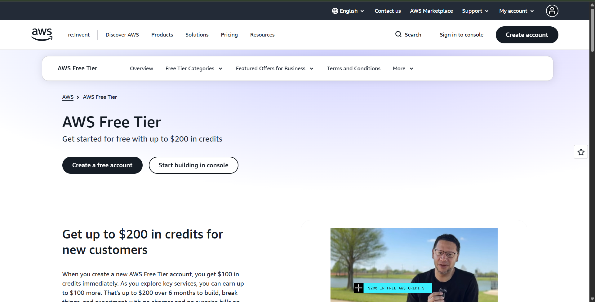

### Step 2: Start the Sign-Up Process

Clicked **Create a free account** and entered the root user email address and an AWS account name to begin registration.

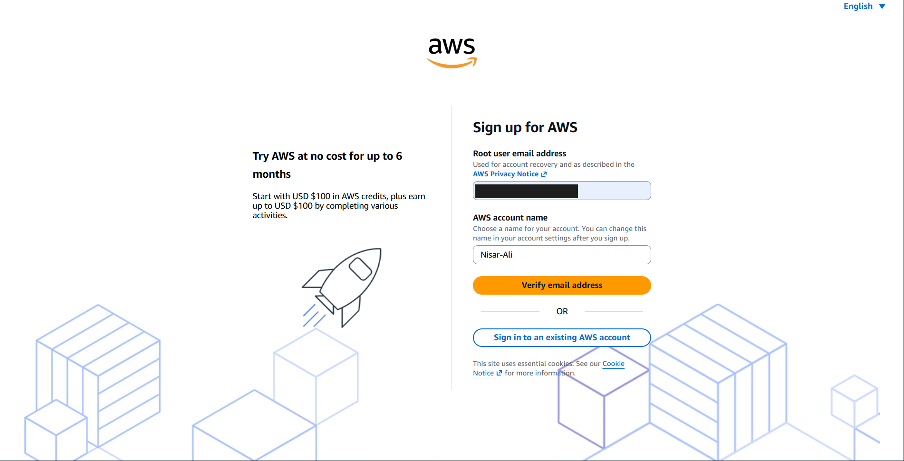

### Step 3: Choose an Account Plan

AWS asks the new user to choose between a **Free plan** (six months, ideal for learning and prototyping) and a **Paid plan** (production-ready workloads). The Free plan was selected for this lab.

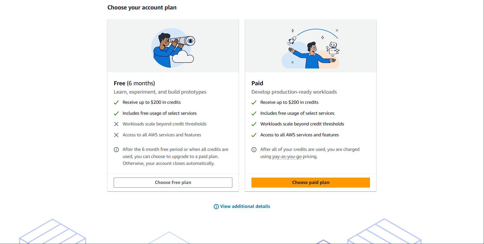

### Step 4: Enter Contact Information

Filled in the contact details (full name, phone number, country/region and address) and agreed to the AWS Customer Agreement before continuing.

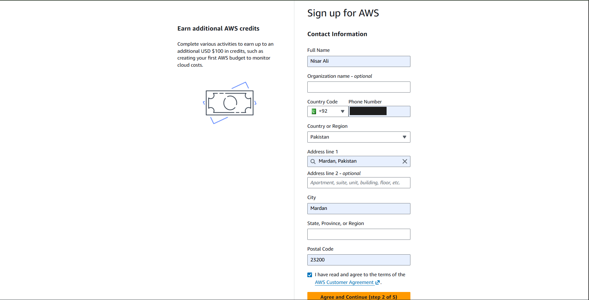

### Step 5: Enter Billing Information

AWS requires billing/card details even for the free plan, to verify identity and enable a smooth upgrade path later. No charge occurs on the free plan unless it is later upgraded.

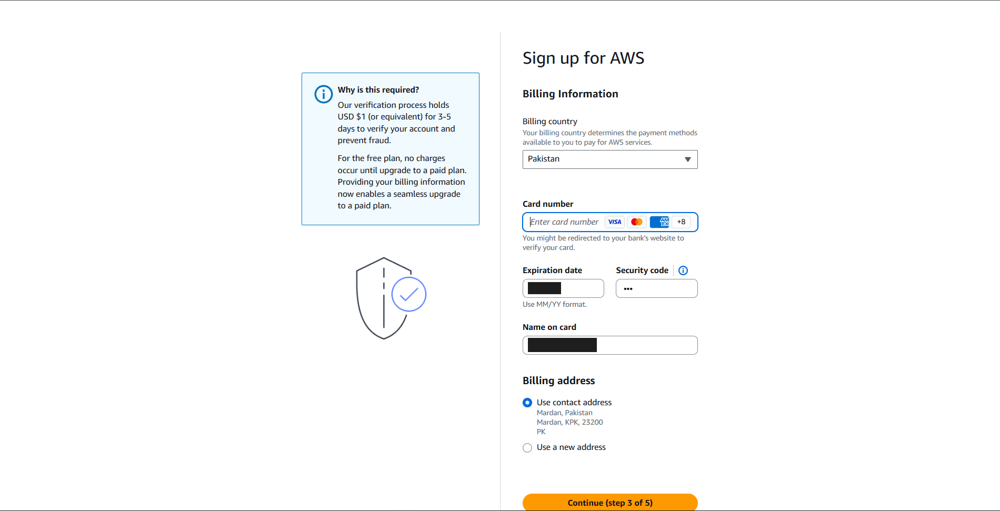

### Step 6: Confirm Identity

A verification code was sent and entered to confirm the identity of the account owner, completing the sign-up flow.

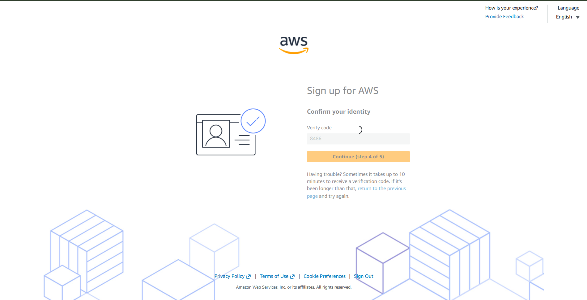

---

## Part 2: Console Home and Billing Overview

Once the account was created, the AWS Management Console became accessible. This section covers logging in and reviewing the billing dashboard.

### Step 7: AWS Management Console Home

After account creation, the Console Home dashboard is displayed, showing widgets such as Recently Visited, Welcome to AWS, AWS Health and Cost and Usage. It is the central starting point for using any AWS service.

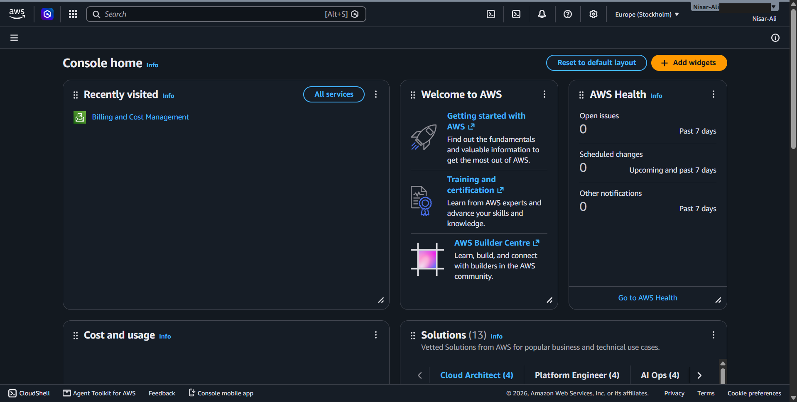

### Step 8: Sign In as Root User

Signed back in to the console using the **Root user** option with the registered email address, which has unrestricted access to the account.

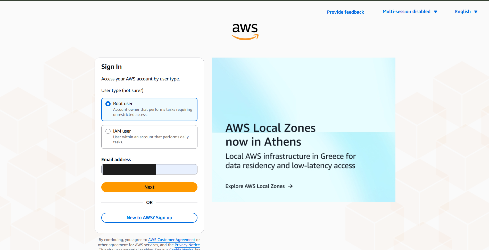

### Step 9: Review the Bills Page

Opened **Billing and Cost Management → Bills** to check the account's charges for the current billing period. Since the account is on the free plan and within the credit allowance, the estimated grand total shows **USD 0.00**.

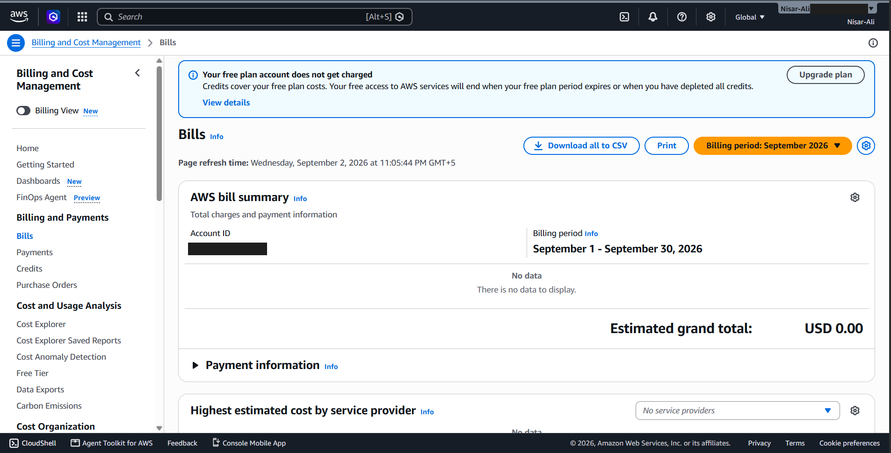

### Step 10: Configure Billing Alert Preferences

Enabled AWS Free Tier alerts and CloudWatch billing alerts to be delivered to the registered email address, so any unexpected usage or cost is flagged early.

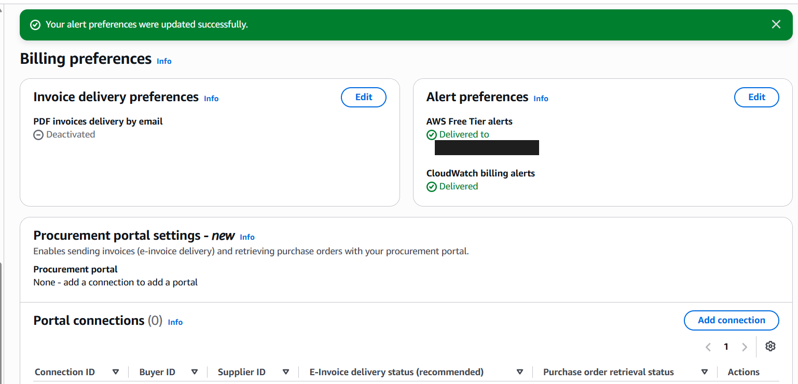

---

## Part 3: Creating a CloudWatch Billing Alarm

To avoid unexpected charges, AWS CloudWatch can trigger an alarm when estimated charges cross a defined threshold. The following steps set up such an alarm.

### Step 11: Open CloudWatch Alarms

Navigated to the CloudWatch service and opened the **Alarms** section, which initially shows zero alarms configured.

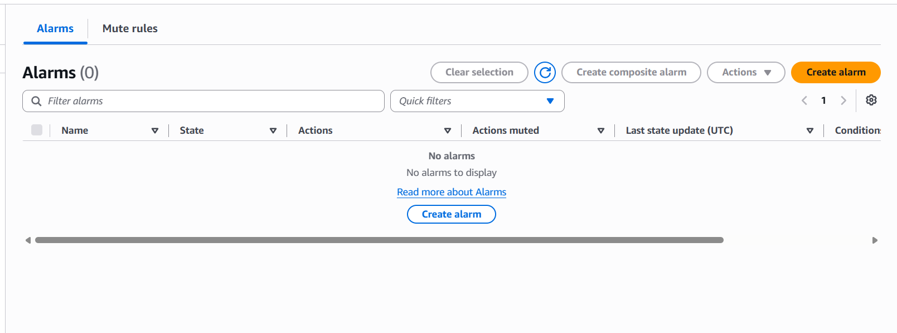

### Step 12: Select the Billing Metric

Chose the `AWS/Billing` namespace and selected the **Total Estimated Charge** (`EstimatedCharges`) metric in USD as the value to monitor.

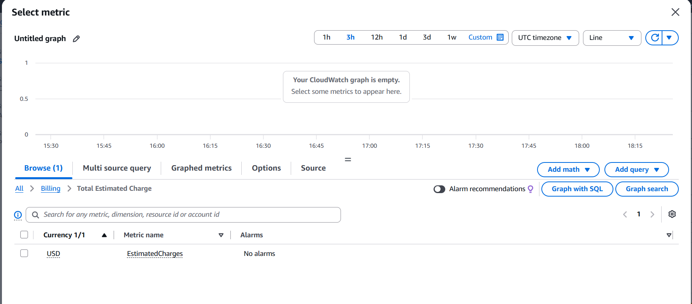

### Step 13: Define the Alarm Condition

Configured a static threshold: the alarm triggers when `EstimatedCharges` is **Greater than 0.1 USD**, evaluated using the **Maximum** statistic over a **6-hour** period.

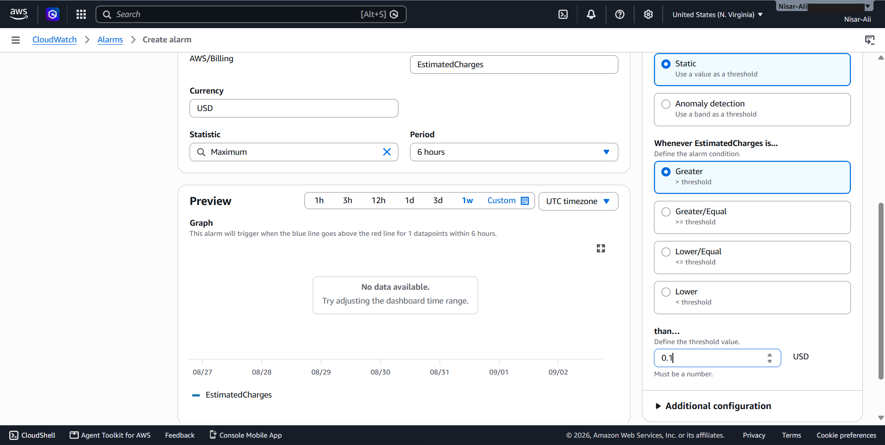

### Step 14: Configure the Notification

Set the alarm to notify on the **In alarm** state by creating a new SNS topic and adding the registered email address as a subscriber, so an email is received if the threshold is crossed.

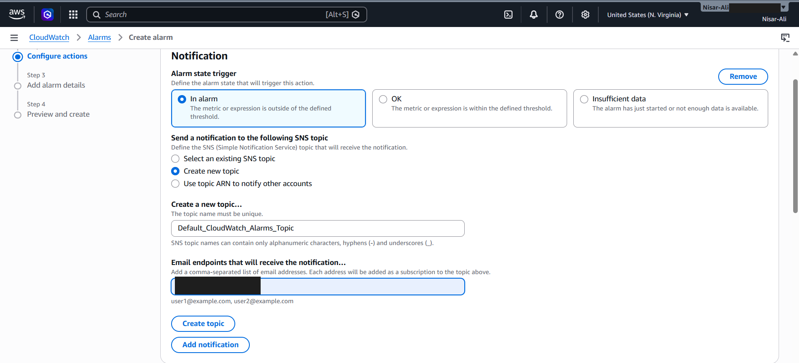

---

## Part 4: Creating an IAM User

Using the root account for everyday work is discouraged. AWS Identity and Access Management (IAM) allows creating separate users with only the permissions they need, which is a core cloud security best practice.

### Step 15: Open the IAM Dashboard

Opened the IAM Dashboard, which summarizes account security recommendations (such as root MFA status) and a count of existing IAM resources.

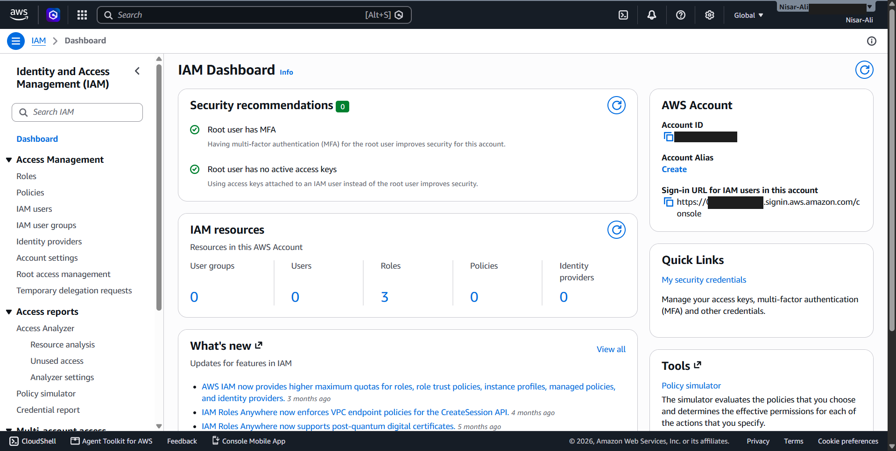

### Step 16: View the IAM Users List

Checked the IAM Users page, which initially shows no users. Only the root account exists at this point.

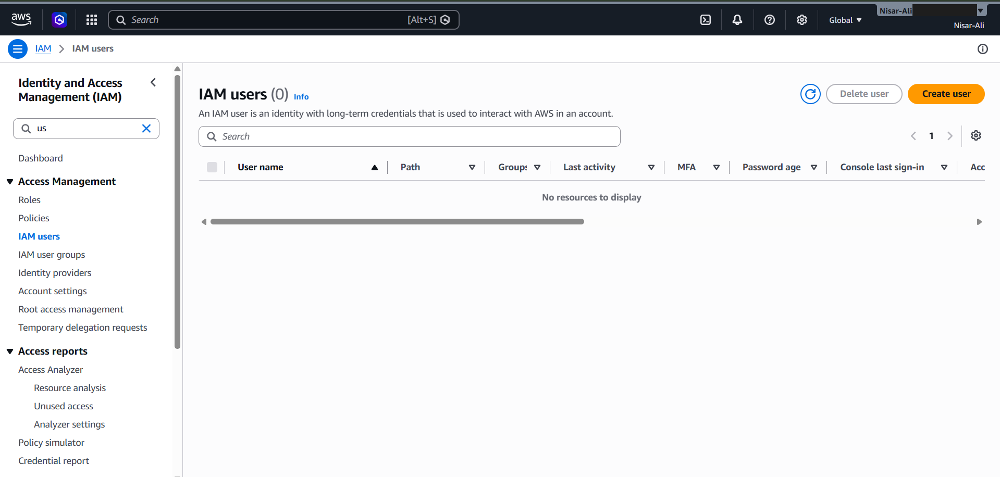

### Step 17: Set Permissions for the New User

While creating a new user, chose **Attach policies directly** and selected the `PowerUserAccess` AWS-managed policy, which grants access to most AWS services without full IAM administration rights.

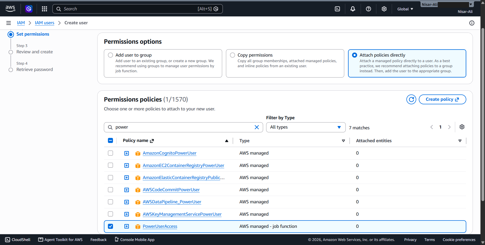

### Step 18: Review and Create the User

Reviewed the summary (user name, auto-generated console password, and the attached `IAMUserChangePassword` and `PowerUserAccess` policies) before confirming creation.

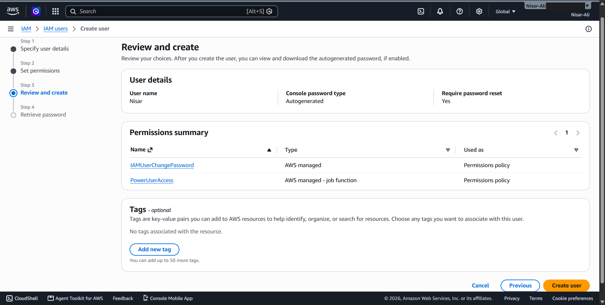

### Step 19: Retrieve the Console Password

After creation, AWS displays the one-time console sign-in URL, user name and auto-generated password, which can be copied, revealed or downloaded as a `.csv` file.

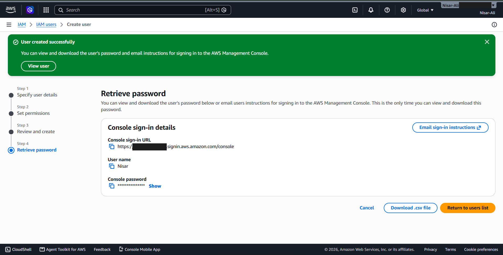

### Step 20: Confirm the User Was Created

Returned to the IAM Users list, which now shows the newly created user with a password set just now, confirming the setup was successful.

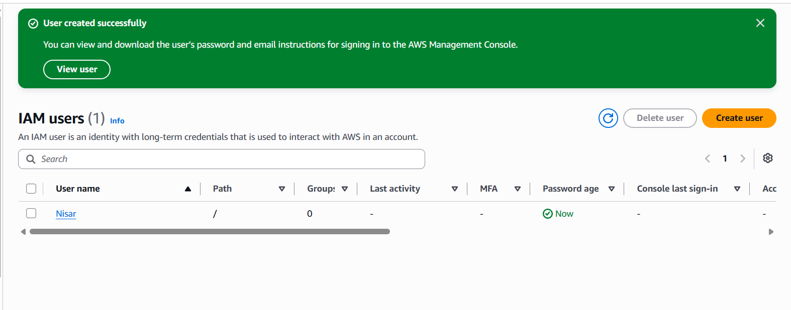

---

## Key Takeaways

- The AWS Free plan needs card details only for identity verification; nothing is charged unless the plan is upgraded.
- A CloudWatch alarm on `EstimatedCharges` gives an early email warning if spending crosses a small threshold (0.1 USD here).
- The root user has unrestricted access, so day-to-day work should be done with an IAM user that has only the permissions it needs.
- The auto-generated IAM console password can be viewed only once, at creation time.

---

## Repository Structure

```
.
├── README.md
├── .gitignore
└── screenshots/
    ├── 01-free-tier-landing.png
    ├── ...
    └── 20-user-created.png
```
